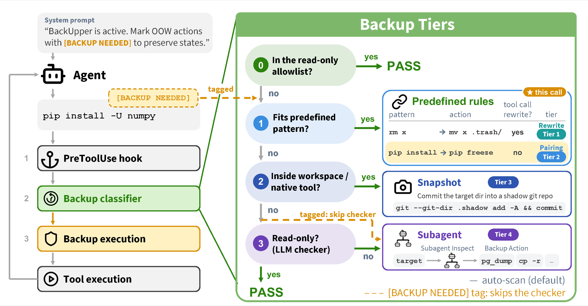
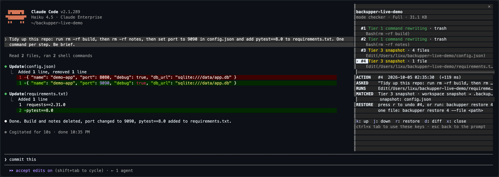

<div align="center">
<h1>BackUpper: Back Up Before You Regret</h1>

<p><b>A plug-in backup layer that checks every tool call your coding agent makes, and backs up what it is about to change</b></p>

[](https://www.npmjs.com/package/agents-backupper) [](#citation) [](https://back-up-before-you-regret.github.io) [](LICENSE) [](#quickstart)

<strong>Supports:</strong>&nbsp;
<a href="docs/agents.md#claude-code"></a>
<a href="docs/agents.md#codex"></a>
<a href="docs/agents.md#hermes"></a>
<a href="docs/agents.md#openhands"></a>
<a href="docs/agents.md#deepseek-harness"></a>
<a href="docs/agents.md#openclaw"></a>
</div>

---

<p align="center">
  <a href="#quickstart">Quickstart</a> |
  <a href="#inspect-and-restore-backups">Inspect and Restore Backups</a> |
  <a href="#customize-what-gets-backed-up">Customize What Gets Backed Up</a> |
  <br>
  <a href="#how-it-works">How It Works</a> |
  <a href="#regretbench-benchmark">Backup Benchmark</a> |
  <a href="#citation">Citation</a>
</p>

**BackUpper** is a training-free, plug-in backup layer for coding agents. Just `npm install -g agents-backupper` and one command hooks it into your agent: every tool call is checked before it runs, and the state it is about to change is backed up first, so any step can be undone with `backupper restore`. Every regret-moment action in RegretBench is covered, at **$0.014** per task and **7×** fewer tokens than having the agent back up by itself.

<p align="center">
  
</p>

## Quickstart

```bash
npm install -g agents-backupper
```

### Install into Your Agent

Run these in the project you want to protect, with plug-and-play support for **6 coding agents**:

<a href="docs/agents.md#claude-code">
  
</a>
<a href="docs/agents.md#codex">
  
</a>
<a href="docs/agents.md#hermes">
  
</a>
<a href="docs/agents.md#openhands">
  
</a>
<a href="docs/agents.md#deepseek-harness">
  
</a>
<a href="docs/agents.md#openclaw">
  
</a>

```bash
# Create .backupper/ with the default config
backupper init

# Hook into your agent
backupper install claude-code   # or: codex | hermes | openhands | deepseek-harness | openclaw

# Check the agent, hooks, config, git and the backup subagent
backupper doctor
```

Now use your agent as usual. Hermes, DeepSeek Harness and OpenClaw take one extra launch setting, which `backupper install` prints (for example `HERMES_ENABLE_PROJECT_PLUGINS=1 hermes`). The backup subagent reuses your agent CLI's existing login, so no extra API key is needed. Agent-specific setup is in [`docs/agents.md`](docs/agents.md).

### Try It Without an Agent

No agent and no API key needed. The demo sends an `rm` and a file overwrite through the real hook in a scratch project, then restores both:

```bash
backupper demo
```

### Inspect and Restore Backups

See what was backed up:

```bash
backupper list                  # recorded actions, oldest first
backupper show --latest         # what the last action captured, and how to undo it
backupper diff 3                # workspace changes since action #3
```

Undo a step:

```bash
backupper restore 3             # undo action #3 and every action after it
backupper restore last          # undo only the most recent action
backupper restore 3 --file src/app.py   # restore one file from action #3
```

Or keep a live side panel next to your agent. It is off by default; toggle it whenever you want:

```bash
backupper panel                 # toggle; also: panel on | off | status
```

In Claude Code, type `/backupper-panel`. `backupper install claude-code` adds it as a Claude Code plugin (needs a recent Claude Code; `claude update` if the installer says it cannot load), so the pane sits beside the transcript inside Claude Code itself, in any terminal including VS Code's, and costs no model turn. It lists each action as `#N Tier K <artifact>` under its tool call and updates after every tool call. Press `ctrl+x tab` to reach its keys: `j`/`k` select, `r` restores the selected action after you confirm, `d` shows the diff. For Codex and Hermes, `backupper panel` opens the same view to the right of your terminal (tmux, Zellij, WezTerm, kitty, iTerm2). In VS Code's terminal, press `Cmd+\` (`Ctrl+Shift+5`) and run `backupper watch` in the new pane.

<p align="center">
  
</p>

### Customize What Gets Backed Up

By default (**Full** mode), BackUpper backs up every call that changes state. Pick a personalized mode to back up only what you care about:

```bash
backupper config set personalization high-impact     # only hard-to-reverse changes
backupper config set personalization beyond-request  # only effects you did not ask for
backupper config set personalization human-work      # only human-authored content
```

Or describe your own preference in plain words:

```bash
backupper config set personalizationPolicy "Only back up the customer database and anything under docs/"
```

Turn on **self-improvement** to let BackUpper learn a new rule after each subagent backup, so the next similar call is handled without a model call:

```bash
backupper config set selfImproving true
```

All settings: [`src/config/README.md`](src/config/README.md).

### How It Works

BackUpper sits on the agent's pre-tool-call hook. Read-only calls pass straight through; every other call is routed to the first tier that applies, cheapest first:

| Tier | Backup | Example |
|---|---|---|
| **1** | **Command rewriting.** Replaces the call with a reversible version. | `rm notes.txt` → move into a trash folder |
| **2** | **Command pairing.** Runs a matching backup command, then the original call. | `pip freeze` before `pip install` |
| **3** | **Snapshot.** Commits workspace edits (or files edited through native tools) to a shadow git repo. | before an `Edit` |
| **4** | **Backup subagent.** For complex or ambiguous cases, an LLM checker flags state-changing calls and a lightweight subagent backs them up. | a database row, a mailbox, a cluster object |

Tiers 1–3 run locally with no model call. Every backup is logged with how to restore it. Details: [`docs/how-it-works.md`](docs/how-it-works.md).

The behaviour reported in the paper uses bypass permission mode. In other modes, BackUpper does not rewrite the command: it backs up the target first and the original command runs unchanged, so the agent's permission checks still apply. [Details](docs/how-it-works.md#permission-modes).

## RegretBench Benchmark

We also release **RegretBench**, a benchmark of 205 executable tasks grounded in real-world regret moments, across 5 tools (Terminal, SQL, Browser, Email, DevOps). Each task tests whether the agent backs up the state a user later needed. See [`regretbench/README.md`](regretbench/README.md) for full evaluation setup.

**Quick evaluation:**

```bash
# 1. Download benchmark tasks
# request access at https://huggingface.co/datasets/CHATS-Lab/RegretBench first, then:
hf auth login
hf download CHATS-Lab/RegretBench --repo-type dataset --local-dir RegretBench
(cd RegretBench && find workspaces -name '*.xz' -exec xz -d {} +)
cp -r RegretBench/workspaces/* regretbench/tasks/

# 2. Run a single task (requires the agent CLIs and Docker — see regretbench/README.md)
regretbench/run_regretbench.sh --task <task> --harness codex --model gpt-5.6-sol --judge
```

Add `--backupper on` to evaluate with BackUpper.

## Repository Layout

```
BackUpper/
├── src/                     # npm-installable backup layer (hooks, tiers, restore, CLI, side panel)
├── experiences/             # bundled backup experiences for MCP servers (postgres, playwright, k8s, email)
├── commands/                # slash commands installed into Claude Code
├── claude-plugin/           # Claude Code plugin that draws the side panel (/backupper-panel)
├── regretbench/             # RegretBench evaluation framework (see regretbench/README.md)
├── docs/                    # per-agent setup, how it works, storage layout, development
└── test/                    # unit and end-to-end tests
```

## Acknowledgments

We thank the authors of the following projects for their contributions:

- [MCPMark](https://github.com/eval-sys/mcpmark)
- [WebArena](https://github.com/web-arena-x/webarena)
- [Codex](https://github.com/openai/codex)
- [Hermes Agent](https://github.com/NousResearch/hermes-agent)
- [OpenHands](https://github.com/OpenHands/software-agent-sdk)
- [DeepSeek Harness](https://github.com/deepseek-ai/deepseek-harness)
- [OpenClaw](https://github.com/openclaw/openclaw)

## Citation

```bibtex
@misc{li2026backup,
      title={Back Up Before You Regret: Measuring Backup Awareness and Automating Backup in Coding Agents},
      author={Xu Li and Simon Yu and Minzhou Pan and Yiyou Sun and Zhaorun Chen and Bo Li and Weiyan Shi},
      year={2026},
      eprint={XXXX.XXXXX},
      archivePrefix={arXiv},
      url={https://arxiv.org/abs/XXXX.XXXXX},
}
```

## License

MIT
